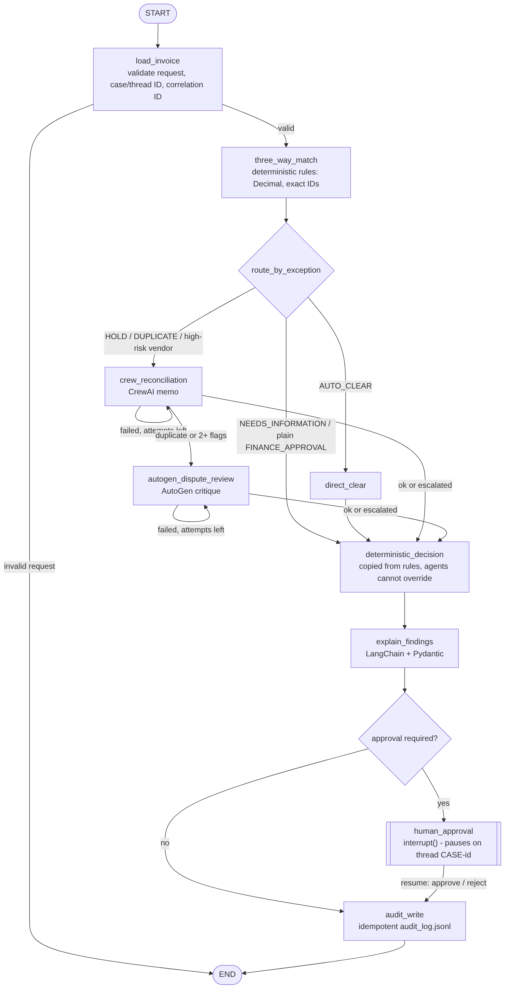

# Invoice Review Agent (Agentic AI assignment)

An assistant that reviews vendor invoices and recommends AUTO_CLEAR, HOLD_FOR_REVIEW,
NEEDS_INFORMATION, POSSIBLE_DUPLICATE or FINANCE_APPROVAL. It never makes a payment.
LangGraph runs the workflow; LangChain, CrewAI and AutoGen explain or advise only.
Only `app/rules.py` decides.

## Team
| Member | Owns |
|---|---|
| Lead | `app/state.py`, `app/graph.py`, `app/approval.py`, `app/errors.py`, `main.py`, final README |
| Niranjan | `data/`, `app/rules.py`, `tests/test_rules.py`, `requirements.txt`, `docs/architecture.png` |
| Aamir | `app/langchain_components.py`, `app/crewai_adapter.py`, `examples/run_crew_standalone.py` |
| Anit | `app/autogen_adapter.py`, `examples/run_autogen_standalone.py`, `tests/test_graph_*.py`, `docs/benchmark.md` |

## Setup
```bash
python -m venv .venv
# Windows: .venv\Scripts\activate     Mac/Linux: source .venv/bin/activate
pip install -r requirements.txt
cp .env.example .env      # Windows: copy .env.example .env
```
Keep `USE_MOCK_LLM=1` to run without an API key.

## Run
See [Run commands](#run-commands) at the end of this file.

## Module sections
_Each member adds a short section below: what the module does and how to run its standalone demo._

### Rules (Niranjan)
### LangChain + CrewAI (Aamir)

### LangChain explanation

`app/langchain_components.py` builds a Pydantic-validated explanation from the case facts and deterministic `rule_result`. The decision, reasons, evidence, and invoice ID are copied from the rule result; the model writes only the summary and next action. Invalid structured output is retried up to two times before an adapter error is raised.

Run with `USE_MOCK_LLM=1` to use the canned explanation without an API key.

### CrewAI invoice investigation

`app/crewai_adapter.py` exposes `run_crew(case_facts, rule_result, correlation_id="", mock=None)`. It runs an invoice analyst and vendor risk analyst and returns an advisory memo, suggested next steps, and model-call count. The crew uses only the supplied facts and cannot change the deterministic decision or initiate payment.

Run the standalone demo from the repository root:

```powershell
python -m examples.run_crew_standalone
```

### AutoGen + tests + benchmark (Anit)

### LangGraph workflow (Lead)

`app/graph.py` is the top-level LangGraph `StateGraph`. It owns the typed state (`app/state.py`), conditional routing, bounded retries, the human-approval interrupt, and the idempotent audit log (`app/approval.py`). Only the deterministic rules decide; CrewAI, AutoGen and LangChain output is advice for the human reviewer and can never change the decision.



Source of the diagram: `docs/architecture_graph.mmd`.

| Node | Purpose |
|---|---|
| `load_invoice` | Validate the request, assign the case/thread ID (`CASE-<invoice>`) and a correlation ID |
| `three_way_match` | Deterministic PO / goods receipt / vendor matching (`app/rules.py`) |
| `route_by_exception` | Conditional branch: `direct_clear`, `crew_reconciliation`, or straight to the decision |
| `crew_reconciliation` | CrewAI memo for holds, duplicates and high-risk vendors (bounded retry loop) |
| `autogen_dispute_review` | AutoGen critique for duplicates or 2+ flags (bounded retry loop) |
| `deterministic_decision` | Decision copied from the rules; agent output is never consulted |
| `explain_findings` | LangChain explanation, validated against the rules, with a plain-Python fallback |
| `human_approval` | `interrupt()`: the graph pauses on the same thread until a human approves or rejects |
| `audit_write` | The only side effect: one idempotent line in `audit_log.jsonl` (no payment) |

More detail: [failure analysis](docs/failure_analysis.md), [answers to the review questions](docs/review_answers.md), [benchmark](docs/benchmark.md).

## Run commands
All commands run from the repository root with the virtual environment active and `USE_MOCK_LLM=1` in `.env`.

```powershell
python main.py --invoice INV-004 --comment "Please check the price mismatch"   # one invoice
python main.py --batch                                                         # all 14 invoices
python main.py --approve INV-004 --actor alice --comment "price confirmed"     # resume a paused case
python main.py --reject  INV-004 --actor alice                                 # or reject it
python main.py --demo interrupt   # pause, replay, resume, replay: exactly one audit entry
python main.py --demo failure     # forced CrewAI timeout: 3 attempts, then escalation
python main.py --examples         # writes examples/*.json and docs/execution_trace.md
python -m pytest -q               # all tests (mocked models, no API key needed)
```

Paused cases are stored in `checkpoints.sqlite`, so `--approve` / `--reject` work from a new terminal. Add `-v` to see log lines with correlation IDs.
